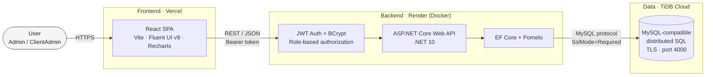
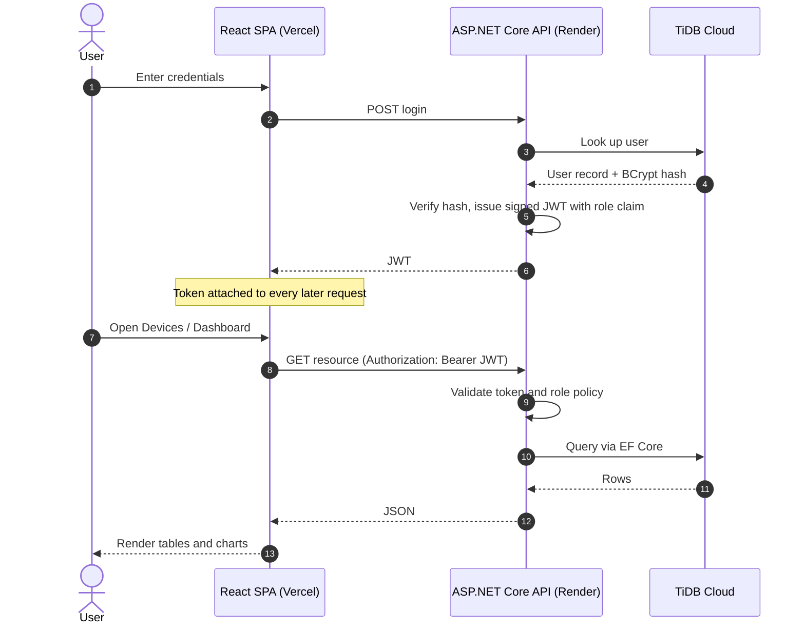
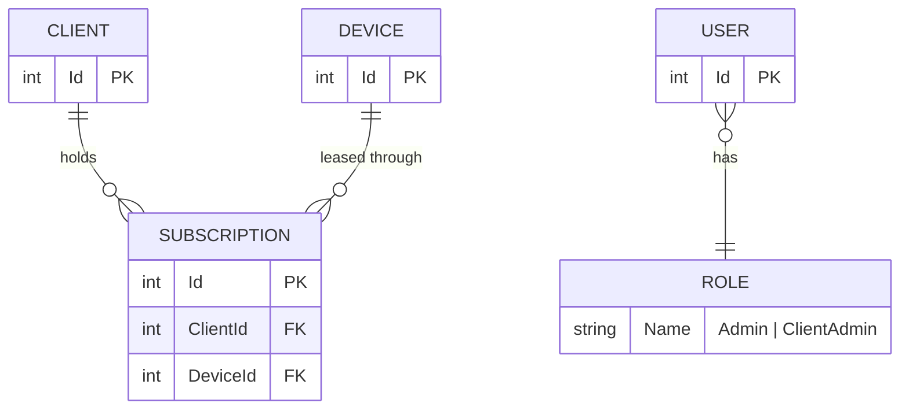
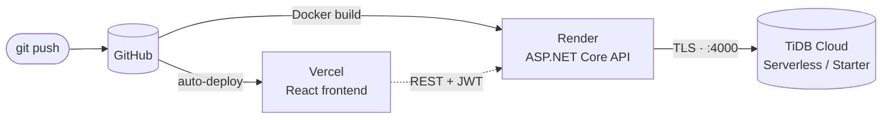

<div align="center">

# MyCotoka

**A cloud-native Device-as-a-Service (DaaS) platform prototype.**
Manage a device fleet, the clients leasing it, and the subscriptions that connect them, from one role-aware dashboard.

[](https://my-cotoka-one.vercel.app)


[**Live demo**](https://my-cotoka-one.vercel.app) · [Architecture](#architecture) · [Quick start](#quick-start) · [Deployment](#deployment)

</div>

---

## Overview

Device-as-a-Service replaces one-off hardware sales with recurring, managed leases. MyCotoka models that lifecycle end to end:

- **Devices**: the inventory a provider owns and leases out
- **Clients**: the organisations leasing those devices
- **Subscriptions**: the plans that tie a client to a device and drive recurring revenue

An analytics dashboard turns that data into fleet health, revenue and churn insights, while role-based access keeps each persona inside its own boundaries.

## Try it live

**[my-cotoka-one.vercel.app](https://my-cotoka-one.vercel.app)**

| Persona     | Username   | Password     | Access                                  |
| ----------- | ---------- | ------------ | --------------------------------------- |
| Admin       | `admin`    | `Admin1234!` | Full platform, including user management |
| ClientAdmin | `testuser` | `Test1234!`  | Client-scoped role                      |

> Demo credentials only. The live API runs on a free tier, so the first request after idle time may take a few seconds to wake up.

## Highlights

| | |
| --- | --- |
| **Full lifecycle CRUD** | Devices, Clients and Subscriptions with search, create, edit and delete |
| **Insight dashboard** | Fleet status, revenue by client, subscription trend, top plans and churn rate |
| **Role-based access** | JWT authentication with BCrypt password hashing and `Admin` / `ClientAdmin` roles |
| **Admin console** | Admin-only Users management page |
| **Production-grade delivery** | Dockerised API, health-checked local database, three-tier cloud deployment |
| **Distributed SQL** | TiDB Cloud (MySQL-compatible) in production, MySQL 8.0 locally |

## Architecture

### System overview



### Authentication and request flow



### Domain model



> The diagram shows the core relationships only. Fields and cardinalities should match the EF Core entities under `backend/MyCotoka.Api`.

## Tech stack

| Layer        | Technology                                                 |
| ------------ | ---------------------------------------------------------- |
| **Frontend** | React, Vite, Fluent UI v9, Recharts                        |
| **Backend**  | ASP.NET Core Web API (.NET 10), EF Core, Pomelo MySQL provider |
| **Database** | TiDB Cloud (production), MySQL 8.0 via Docker (local)      |
| **Auth**     | JWT bearer tokens, BCrypt hashing, role-based authorization |
| **Infra**    | Docker, Docker Compose, Vercel, Render                     |

## Deployment



| Layer       | Host                                                       |
| ----------- | ---------------------------------------------------------- |
| Frontend    | [Vercel](https://vercel.com)                               |
| Backend API | [Render](https://render.com) (Docker)                      |
| Database    | [TiDB Cloud](https://tidbcloud.com) (Serverless / Starter) |

Secrets never live in the repo. In production the connection string and JWT key are injected as environment variables on Render:

```text
ConnectionStrings__DefaultConnection   # TiDB host, port 4000, SslMode=Required
Jwt__Key                               # signing key
```

## Quick start

**Prerequisites:** Docker Desktop, Node.js 18+, and the .NET 10 SDK (Option 2 only).

### Option 1: Docker (API + database, no .NET SDK needed)

```bash
# 1. Generate a JWT signing key
echo "JWT_KEY=$(openssl rand -base64 32)" > .env

# 2. Start the API and MySQL
docker compose up -d --build

# 3. Start the frontend
cd frontend/mycotoka-web
npm install
npm run dev
```

| Service  | URL                     |
| -------- | ----------------------- |
| API      | `http://localhost:5017` |
| Frontend | `http://localhost:5173` |

Verify both containers are healthy with `docker ps`. You should see `mycotoka-mysql` and `mycotoka-api` as `Up`.

### Option 2: Local backend with `dotnet run` (MySQL still in Docker)

```bash
docker compose up -d mysql

cd backend/MyCotoka.Api
dotnet user-secrets init
dotnet user-secrets set "Jwt:Key" "$(openssl rand -base64 32)"
dotnet user-secrets set "ConnectionStrings:DefaultConnection" \
  "server=localhost;port=3306;database=mycotoka_db;user=mycotoka_user;password=mycotoka_pass"
dotnet run
```

In a separate terminal:

```bash
cd frontend/mycotoka-web
npm install
npm run dev
```

> The backend and frontend each run in their own terminal. Neither starts the other.

## Project structure

```text
MyCotoka/
├── backend/
│   └── MyCotoka.Api/        # ASP.NET Core Web API, EF Core data layer, auth
├── frontend/
│   └── mycotoka-web/        # React + Vite + Fluent UI dashboard
├── docker-compose.yml       # Local API + MySQL with health checks
└── README.md
```

